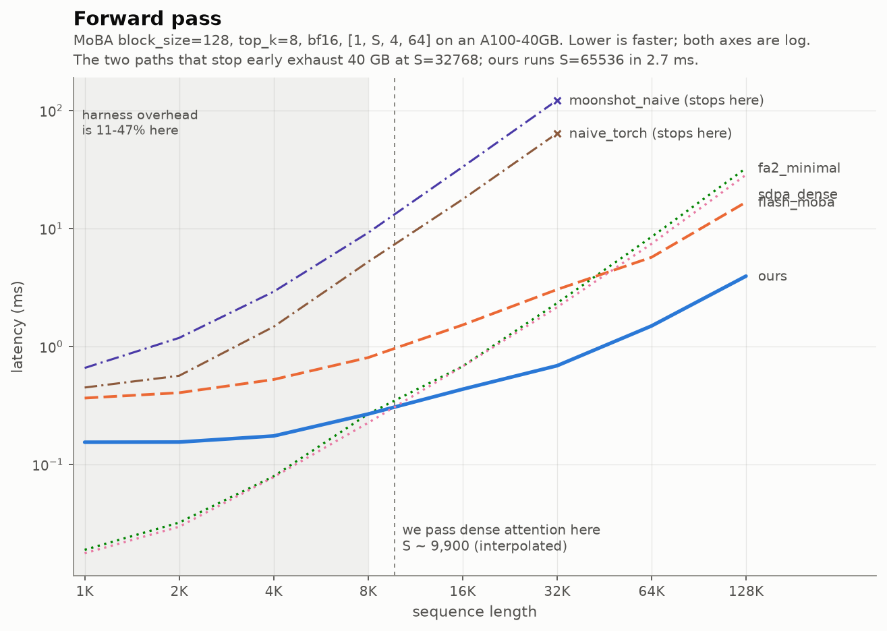
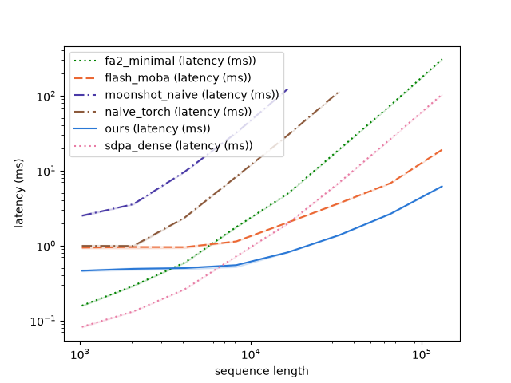
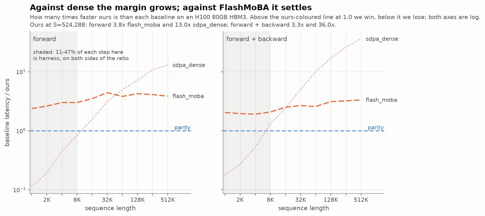
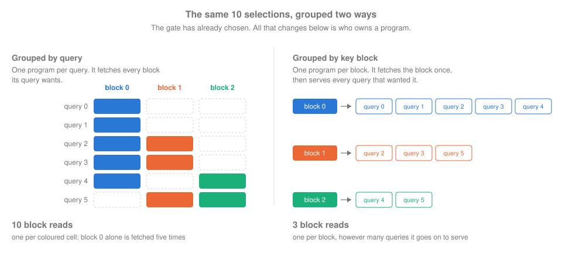
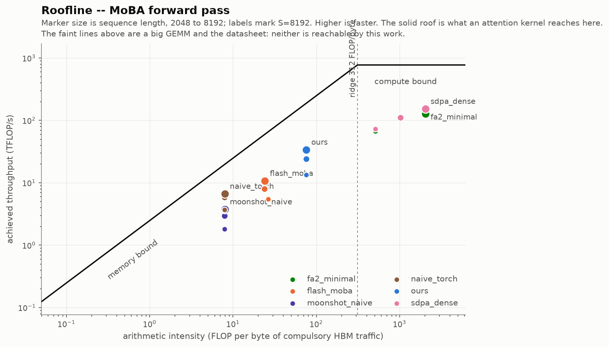

# MoBA Triton Kernel

A [Triton](https://triton-lang.org) implementation of MoBA, Mixture of Block
Attention ([Lu et al., Moonshot AI](https://arxiv.org/abs/2502.13189)).

MoBA is sparse attention in which every query picks its own handful of key
blocks. That per-query choice is what makes it cheap on paper and awkward on a
GPU, because it breaks the assumption FlashAttention is built on. This kernel
inverts FlashAttention's loop order: a program owns one key block and gathers
the queries that chose it, rather than owning a query tile and loading the
union of whatever its queries asked for.

Forward and backward, grouped-query attention and variable-length packing are
all implemented. Correctness is checked against a PyTorch oracle that matches
MoonshotAI's reference bitwise, block choice for block choice.

## Results

Measured on an H100 80GB HBM3 at `block_size=128, top_k=8`, bf16, shape
`[1, S, 4, 64]`, which is FlashMoBA's published configuration.





This is what was measured: wall-clock latency, from which everything else on
this page is derived. Two lines stop early because those implementations run
out of memory, which is itself the result at that end of the axis.

Both passes are here because you cannot train with a forward pass. The backward
carries the widest margin against dense attention and the narrower one against
FlashMoBA, 3.3x rather than 3.9x at 524K, which is the honest reason not to
show the forward alone.

| S | forward | vs FlashMoBA | vs dense | backward | vs FlashMoBA | vs dense |
|---:|---:|---:|---:|---:|---:|---:|
| 65,536 | 1.49 ms | 3.8x | 5.0x | 2.66 ms | 2.6x | 10.0x |
| 131,072 | 3.94 ms | 4.2x | 7.2x | 6.18 ms | 3.1x | 16.8x |
| 524,288 | 38.2 ms | 3.9x | 13.0x | 47.0 ms | 3.3x | 36.0x |

Above, a speedup is the vertical gap between two lines and its trend is a
difference of slopes. Dividing shows both directly, at the cost of absolute
scale, which is why both figures are here:



Two different things are happening. Against dense attention the margin keeps
growing, because dense work is quadratic in S and this is not. Against
FlashMoBA, which is also sparse, the ratio settles around 4x: both kernels are
linear in S, and what separates them is a constant factor in how much memory
traffic each spends per selected block.

The same shape holds on an A100-PCIE-40GB, where at S=65536 the forward is 4.6x
FlashMoBA and 5.8x dense ([`docs/a100-results.md`](docs/a100-results.md)). Two
architectures, one ordering.

Past S=131072 the dense baselines stop being a comparison and become a
demonstration: PyTorch's own reference runs out of memory at S=32768 trying to
allocate 16 GiB, because the score matrix is quadratic in S.

## Why per-query selection is hard

FlashAttention's speed rests on one trick. Load a tile of keys into on-chip
memory once, then reuse that load across a whole tile of queries: one expensive
trip to HBM, many cheap uses.

MoBA removes the precondition. Two adjacent queries routinely select different
blocks, so a query-major program has to load the union of everything its
queries asked for and then mask away what each individual query did not want.
The masked-away part is tensor-core work that gets computed and thrown out, and
it gets worse as context grows:

| S | blocks | tile utilization | discarded |
|---:|---:|---:|---:|
| 4,096 | 32 | 0.43 | 57% |
| 8,192 | 64 | 0.23 | 77% |
| 16,384 | 128 | 0.12 | 88% |

That is the direction MoBA exists to scale in, so the waste grows exactly where
the method is meant to pay off. The table describes a query-major kernel that
masks, which is what FlashAttention's variable-length path gives both the
community Triton port and MoonshotAI's fused implementation. FlashMoBA avoids
it by gathering per block as well, but only inside a window of 512 to 1024
queries, so at long context its tiles are mostly padding
([`docs/traffic-derivation.md`](docs/traffic-derivation.md)).

The fix is to invert the loop. A program owns one KV block and gathers exactly
the queries that selected it, so every key it loads is used by every query it
holds.

| | FlashAttention-2 | This kernel |
|---|---|---|
| A program owns | a tile of queries | a tile of keys |
| It loops over | key blocks | the queries that chose this block |
| Which keys it loads | a contiguous range | one block, always used in full |
| Wasted tensor-core work | none, it is dense | none, by construction |
| Softmax normalizer | complete when the loop ends | incomplete, needs a merge pass |
| Numerics, tiling, SRAM budget | same | same |

The last two rows are the trade. Inverting the loop buys full utilization and
costs output ownership, because a query's answer now arrives in pieces from
several programs. A final pass rescales and sums those pieces, which is the
same algebra FlashAttention already runs between loop iterations, moved to run
across programs instead of across iterations.

## The transpose

All the gate produces is a list of selections: which key blocks each query
wants. Six queries and three blocks is small enough to count by hand.



The arithmetic is identical on both sides. All that changes is which program
owns what, and that decides how often a key block travels in from memory: once
per selection when a program owns a query, once per block when a program owns
a block. Fetching is the expensive part, so the kernel groups by block, and it
needs that form before it starts, because a program cannot fetch its block
until it knows which queries will use it.

Real programs own a tile of many queries rather than one, so the counts are not
literally ten against three. The mechanism is the same, and at full size it
shows up as the discarded work in the table above.

Grouping by block also creates the kernel's main open problem. The three
programs do not have equal work: block 0 serves five queries and block 2 serves
two, because early blocks are visible to every later query and late blocks to
almost nobody. On real selections that skew reaches 6.2x in the worst case, and
the programs run at the same time, so the slowest sets the pace. Those same
five queries are why block 0 is worth loading once and why its program finishes
last, so no scheduler can remove the imbalance without giving up the saving.

The grouping is stored as compressed sparse column and built entirely on the
GPU with a count, a prefix sum and a scatter, using no `nonzero()` anywhere.
`nonzero()` returns a data-dependent number of results, which forces a copy
back to the CPU before PyTorch can allocate. That round trip costs about 230 us
against about 6 us for the same arithmetic kept on device.

## Using it

Requires a CUDA GPU and Linux or WSL2. Triton has no native Windows support.

```bash
git clone https://github.com/ZuricZ/moba-triton.git
cd moba-triton
uv sync                      # torch is pinned to the cu126 index
uv run pytest -m "not slow"
```

The public API is two names:

```python
import torch
from moba import MoBAConfig, moba_attention

B, S, H, D = 1, 8192, 8, 64
q, k, v = (torch.randn(B, S, H, D, device="cuda", dtype=torch.bfloat16,
                       requires_grad=True) for _ in range(3))

cfg = MoBAConfig(block_size=128, top_k=8)
out = moba_attention(q, k, v, cfg)      # [B, S, H, D]
out.sum().backward()                    # dq, dk, dv
```

Tensors crossing the API are token-major `[B, S, H, D]`, matching
FlashAttention and every reference implementation.

Three optional arguments cover the rest. `causal=True` masks within the query's
own block, since blocks wholly in the past need no mask. `cu_seqlens` takes
packed variable-length batches, where each sequence attends independently.
`index` accepts a precomputed routing index, which holds block selection fixed
while the inputs vary.

The gate itself receives no gradient. MoBA's routing is a hard top-k, and the
backward reuses the forward's selection as a fixed sparsity pattern, matching
MoonshotAI's reference. `MoBAConfig` carries four further flags pinning down
details the paper leaves open, such as tie-breaking and whether a query's own
block consumes a `top_k` slot. The reasoning is in
[`src/moba/config.py`](src/moba/config.py).

## Where the kernel is pinned

A roofline places each implementation by how much arithmetic it does per byte
it moves. Left of the ridge a kernel is limited by memory and cannot go faster
without moving fewer bytes, however well it is written.



Every MoBA implementation is far left of the ridge, so this is a memory-bound
problem and the design was built on that assumption. The useful comparison is
between the two sparse kernels at S=8192:

| | arithmetic intensity | achieved | its own roof | fraction reached |
|---|---:|---:|---:|---:|
| ours | 75.8 FLOP/byte | 32.1 TFLOP/s | 187.0 | 17% |
| FlashMoBA | 24.1 FLOP/byte | 10.7 TFLOP/s | 59.5 | 18% |

Both reach about the same fraction of the ceiling their own position allows, so
neither is running the machine harder than the other. The entire lead is the
position on the x axis: ours needs 3.14x fewer bytes for the same work, which
is exactly the byte ratio the residual analysis derives independently at this
length ([`docs/why-we-beat-flashmoba.md`](docs/why-we-beat-flashmoba.md)).

That is the claim the whole design rests on. The win is not better tuning, it
is that a program owning a key block asks for less memory than a program owning
a query tile. The A100 and the 3050 Ti say the same at different scales, in
`results/<card>/figures/roofline.png`.

## Scope

This is a learning project, and the numbers above come with three limits.

**One configuration.** Everything here is `block_size=128, top_k=8` at
`[1, S, 4, 64]`, because that is what FlashMoBA publishes. A block-size sweep
is in [`docs/block-size-results.md`](docs/block-size-results.md), but the
headline is a single point.

**Two rented cards.** The H100 and A100 runs each lasted one session and both
machines are gone, so nothing here can be re-measured without renting again.
The development machine is a 4 GB laptop that cannot hold these shapes.

**Speed is not quality.** Selection is verified against the oracle, but nothing
here trains or evaluates a model, so none of this says whether MoBA is a good
idea. It says how fast this implementation of it runs.

## Future work

The gate is now the bottleneck. At S=524288 block selection is 87% of the
forward pass, while the attention half on its own is 21x FlashMoBA's.
Selection is quadratic in S, since every query scores every past block, and
attention is linear, so the gate is what holds the whole-pipeline ratio near
4x.

The obvious fix does not work. Replacing the hand-rolled merge loop with
Triton's `tl.topk` was built, verified bit-identical against the shipping
kernel, and measured at 1.04x to 1.10x
([`docs/gate-topk-measurements.md`](docs/gate-topk-measurements.md)). At
32-wide chunks and k=8 a bitonic network and a hand-rolled loop cost the same
number of cross-lane operations, so there is no asymptotic regime to enter. The
lever is merging less often, which means coarse-to-fine selection, and that
changes which blocks get chosen rather than how they are found.

The other open item is the memory this design trades for its speed. The
attention stage writes one partial output per (query, selected block) into a
buffer shaped `[B, H, S, top_k, D]`, allocated across the whole sequence, which
is `top_k` copies of the output:

| shape | partials buffer |
|---|---:|
| `[1, 65536, 4, 64]`, top_k 8 | 268 MB |
| `[2, 1048576, 16, 128]`, top_k 8 | 64 GiB |

The second is FlashMoBA's 1M benchmark shape, and it does not fit an 80 GB
card. That is the cost of the inversion rather than an oversight: allocating
across all of S is what lets a block-owning program gather over the entire
sequence and keep its tiles full, and FlashMoBA made the opposite trade,
holding scratch at one copy of the output and paying for it in padding at every
length. The fix needs no kernel change, only chunking the queries host-side and
reusing the buffer, but it is unbuilt
([`docs/deferred-decisions.md`](docs/deferred-decisions.md) DD-2).

One gap in the comparison, for completeness: the community Triton port crashes
above S=65536 on this harness, so it appears in the A100 table and not in the
long sweeps.

## Reading further

[Loop order and memory
traffic](docs/learning/01-loop-order-and-memory-traffic.md) builds the argument
above from first principles and assumes no GPU background; [anatomy of a
FlashAttention kernel](docs/learning/02-anatomy-of-a-flash-attention-kernel.md)
reads a real Triton kernel and then breaks it on purpose.

For the measurements, [`docs/h100-results.md`](docs/h100-results.md) has the
full sweep, [`docs/why-we-beat-flashmoba.md`](docs/why-we-beat-flashmoba.md)
separates how much of the win is byte count and how much is efficiency,
[`docs/flashmoba-digest.md`](docs/flashmoba-digest.md) reads FlashMoBA's CUDA
line by line, and [`docs/environment.md`](docs/environment.md) pins every
version and the reference commit each number was measured against.

The rest of `docs/` holds the individual measurements, including three
occasions where a result flattered this kernel and turned out to be a
measurement artifact.

## Layout

```
src/moba/                 the library, and nothing else
  config.py               MoBAConfig: semantics flags, block arithmetic
  naive.py                the PyTorch oracle, an executable definition of MoBA
  kernels/
    pooling.py            block to representative key
    gating.py             queries against representatives, top-k blocks
    routing.py            that choice, transposed into CSC
    moba_fwd.py           one program per (KV block, batch, KV head)
    moba_bwd.py           the backward of the same
    tuning.py             host-side launch policy the kernels share
    attention.py          the two halves as one differentiable op

implementations/          uniform adapters for the head-to-head
bench/                    benchmark drivers, run as modules
tests/                    the suite, plus the tolerance policy
docs/                     measurements and learning notes
```

`implementations/` and `tests/` sit outside the package on purpose. Nothing
under `src/moba` may import either, so the library ships without the harness.

## References

- MoBA, Lu et al., Moonshot AI: [arXiv:2502.13189](https://arxiv.org/abs/2502.13189)
- FlashMoBA, Xiao, Guo, Mazaheri, Han (MIT Han Lab): [arXiv:2511.11571](https://arxiv.org/abs/2511.11571), the performance target
- FSA: [arXiv:2508.18224](https://arxiv.org/abs/2508.18224), the same loop-order problem solved for NSA
- FlashAttention: [arXiv:2205.14135](https://arxiv.org/abs/2205.14135) and FlashAttention-2: [arXiv:2307.08691](https://arxiv.org/abs/2307.08691)

Reference implementations are vendored read-only under `references/`
(gitignored) and are never modified. Fetch them with
`scripts/fetch_references.sh`.
